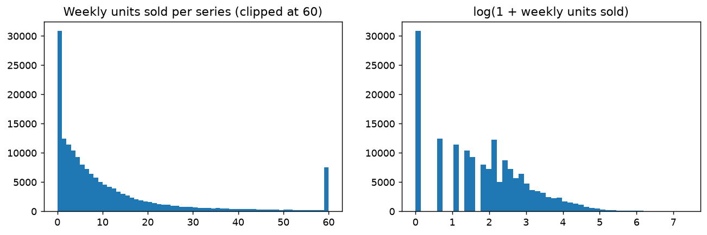
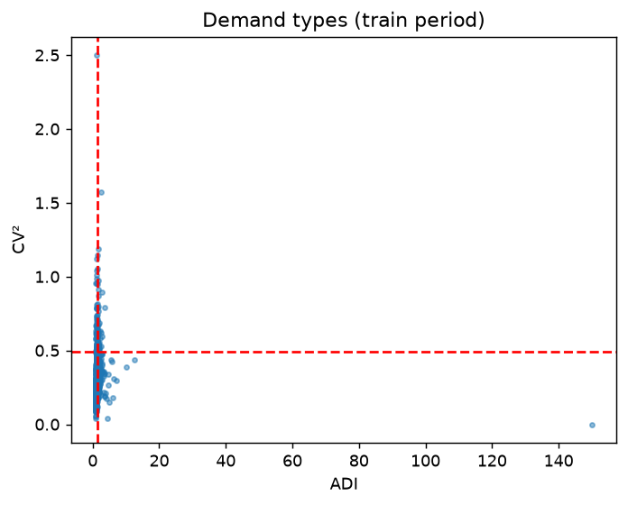
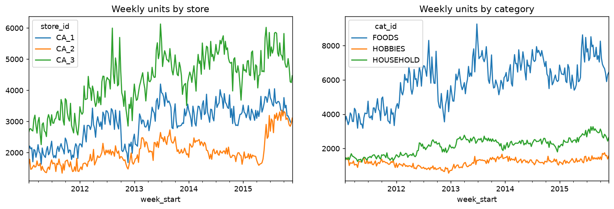
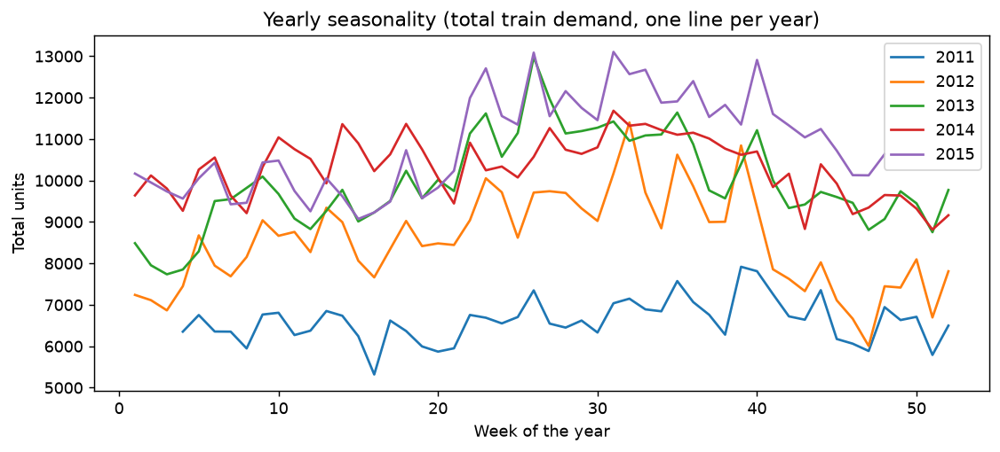
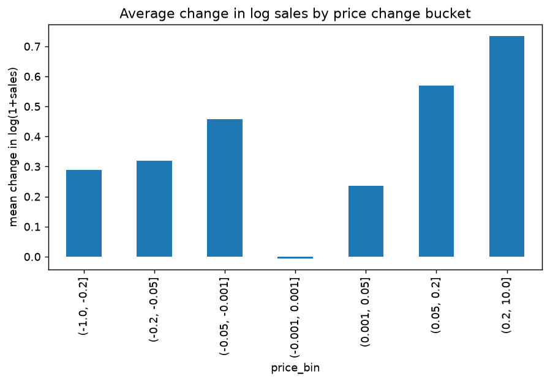
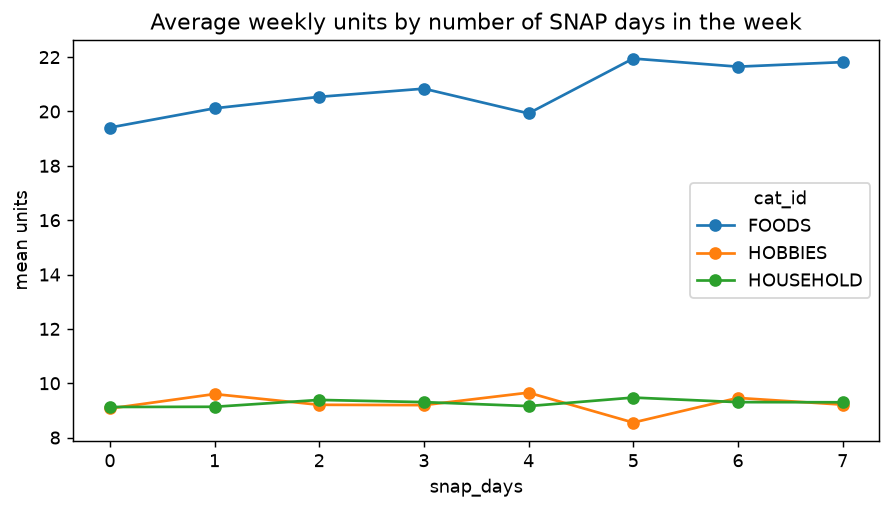
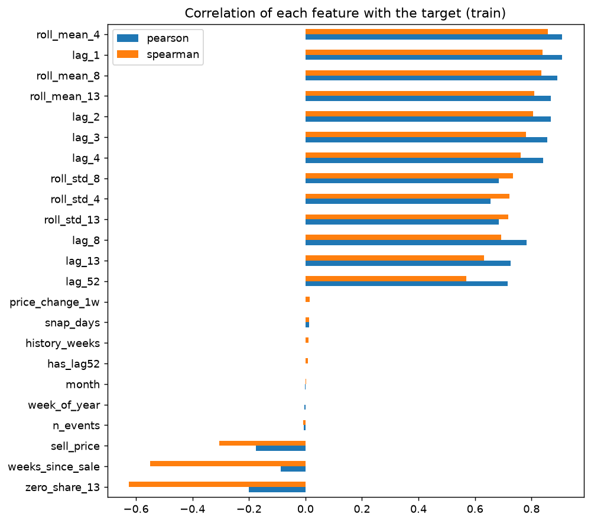
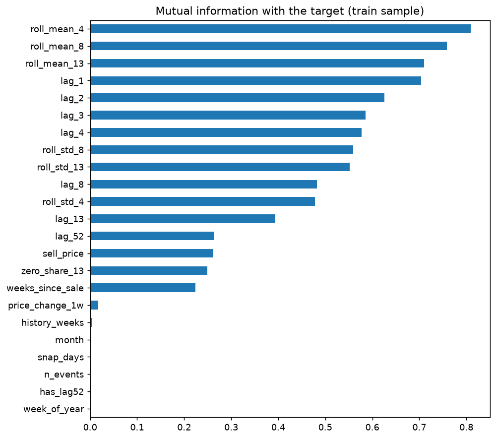

# EDA summary (train period only)

Generated by `python -m scripts.run_eda`. Decisions marked *suggested* are rule-based:
the owner of the EDA reviews each one and edits this file if a rule does not fit.

## 1. Target distribution

| dept_id | mean | std | median | max | skew | kurtosis | pct_zero |
|---|---|---|---|---|---|---|---|
| FOODS_1 | 19.49 | 27.86 | 9 | 292 | 2.661 | 9.16 | 0.124 |
| FOODS_2 | 9.56 | 13.33 | 5 | 163 | 2.964 | 13.56 | 0.236 |
| FOODS_3 | 24.97 | 56.76 | 11 | 1574 | 7.453 | 84.15 | 0.153 |
| HOBBIES_1 | 11.08 | 18.65 | 4 | 252 | 3.215 | 13.59 | 0.153 |
| HOBBIES_2 | 2.687 | 5.249 | 1 | 98 | 5.868 | 55.97 | 0.352 |
| HOUSEHOLD_1 | 14.56 | 25.5 | 7 | 402 | 5.278 | 40.47 | 0.146 |
| HOUSEHOLD_2 | 4.176 | 5.505 | 2 | 79 | 3.033 | 15.62 | 0.256 |

**Evidence:** 18.6% of weeks are zero, skewness 10.40, kurtosis 190.0.

**Suggested decision:** Use quantile (pinball) loss. Report WAPE, and compute MAPE only on weeks with y > 0. Keep the long right tail (the policy needs q95 and q99).

## 2. Demand types (ADI / CV2)

| demand_type | n_series |
|---|---|
| smooth | 574 |
| intermittent | 224 |
| erratic | 51 |
| lumpy | 50 |

**Evidence:** 274 of 899 series (30%) are intermittent or lumpy.

**Suggested decision:** The evaluation harness reports intermittent and lumpy series separately (use series_type.csv).

## 3. Demand over time

| index | count | mean | std | min | 25% | 50% | 75% | max |
|---|---|---|---|---|---|---|---|---|
| y | 253 | 9272 | 1800 | 5319 | 7812 | 9570 | 1.063e+04 | 1.31e+04 |
| n_series | 253 | 655.7 | 181.5 | 309 | 497 | 672 | 843 | 899 |

**Evidence:** Series on sale go from 309 to 899: part of the rise in totals is new items, not growth.

**Suggested decision:** store_id, dept_id and cat_id are features (levels differ). Read totals with the assortment growth in mind.

## 4. Seasonality, autocorrelation and STL

| index | value |
|---|---|
| acf_lag52 | 0.364 |
| acf_lag1 | -0.2045 |
| stl_seasonal_share | 0.2035 |
| acf_confidence_band | 0.1235 |
| stl_residual_share | 0.08886 |

**Evidence:** ACF of the weekly change: lag 1 = -0.20, lag 52 = 0.36 (band +/-0.12). STL: seasonal part explains 20% of the variance.

**Suggested decision:** Keep lag_52 and week_of_year (yearly pattern outside the confidence band).

## 5. Price effect

| price_bin | mean | count |
|---|---|---|
| (-1.0, -0.2] | 0.2897 | 105 |
| (-0.2, -0.05] | 0.319 | 435 |
| (-0.05, -0.001] | 0.4575 | 218 |
| (-0.001, 0.001] | -0.0054 | 163206 |
| (0.001, 0.05] | 0.2355 | 294 |
| (0.05, 0.2] | 0.5696 | 591 |
| (0.2, 10.0] | 0.7351 | 143 |

**Evidence:** Mean change in log sales: +0.313 after a price cut (> 5%), +0.602 after a price rise.

**Suggested decision:** Price effect is not visible in this view. Keep the price features, check SHAP later.

## 6. SNAP days and events

| cat_id | no event week | event week |
|---|---|---|
| FOODS | 20.35 | 20.18 |
| HOBBIES | 9.19 | 9.17 |
| HOUSEHOLD | 9.29 | 9.12 |

**Evidence:** Spearman(snap_days, log sales) = +0.015; event weeks sell 0.99x the non-event average.

**Suggested decision:** Keep snap_days and n_events as known-future covariates (assumption: the calendar is known in advance).

## 7. Outliers

| cat_id | outlier_share |
|---|---|
| FOODS | 0.0035 |
| HOBBIES | 0.0027 |
| HOUSEHOLD | 0.0019 |

**Evidence:** 0.28% of weeks are above Q3 + 3 IQR of their series.

**Suggested decision:** Flag but KEEP outliers: spikes are real demand and the inventory policy depends on q95 and q99.

## 8. Feature correlations with the target

| index | pearson | spearman |
|---|---|---|
| roll_mean_4 | 0.908 | 0.857 |
| lag_1 | 0.908 | 0.839 |
| roll_mean_8 | 0.891 | 0.836 |
| roll_mean_13 | 0.869 | 0.81 |
| lag_2 | 0.869 | 0.805 |
| lag_3 | 0.855 | 0.782 |
| lag_4 | 0.842 | 0.763 |
| roll_std_8 | 0.685 | 0.736 |
| roll_std_4 | 0.655 | 0.721 |
| roll_std_13 | 0.685 | 0.718 |
| lag_8 | 0.783 | 0.692 |
| lag_13 | 0.726 | 0.632 |
| lag_52 | 0.715 | 0.57 |
| price_change_1w | 0.001 | 0.015 |
| snap_days | 0.014 | 0.014 |

**Evidence:** Strongest by Spearman: roll_mean_4, lag_1, roll_mean_8.

**Suggested decision:** Lags and rolling means are the core features. Weak features stay for tree models and are checked with SHAP.

## 9. Collinearity (VIF)

| index | vif |
|---|---|
| lag_1 | 1.001e+15 |
| lag_2 | 1.001e+15 |
| lag_3 | 1.001e+15 |
| lag_4 | 1.001e+15 |
| roll_mean_4 | 1.001e+15 |
| roll_mean_8 | 166.6 |
| month | 152 |
| week_of_year | 151.8 |
| roll_mean_13 | 120 |
| roll_std_8 | 16.27 |
| lag_8 | 11.6 |
| roll_std_13 | 10.86 |
| lag_13 | 10.79 |
| roll_std_4 | 7.444 |
| zero_share_13 | 1.516 |

**Evidence:** 13 of 21 features have VIF > 10: lag_1, lag_2, lag_3, lag_4, roll_mean_4, roll_mean_8, month, week_of_year ....

**Suggested decision:** LightGBM is unaffected. For the linear model use Ridge or regularized quantile regression, and do not feed roll_mean_4 together with lag_1..lag_4 (perfect linear combination).

## 10. Mutual information

| index | mutual_information |
|---|---|
| roll_mean_4 | 0.8096 |
| roll_mean_8 | 0.7589 |
| roll_mean_13 | 0.7097 |
| lag_1 | 0.7036 |
| lag_2 | 0.6259 |
| lag_3 | 0.5856 |
| lag_4 | 0.5777 |
| roll_std_8 | 0.5596 |
| roll_std_13 | 0.5519 |
| lag_8 | 0.4826 |

**Evidence:** Most informative: roll_mean_4, roll_mean_8, roll_mean_13, lag_1, lag_2.

**Suggested decision:** Confirms which features carry non-linear signal. Features near zero are candidates to drop for the deep model.
